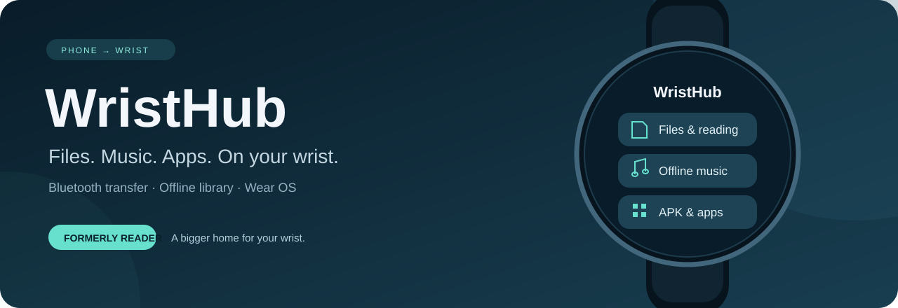
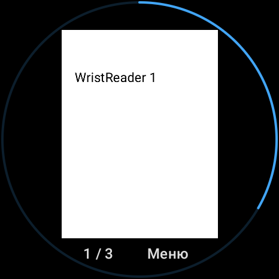
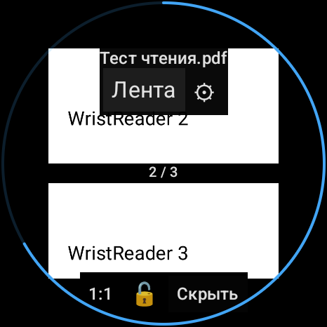
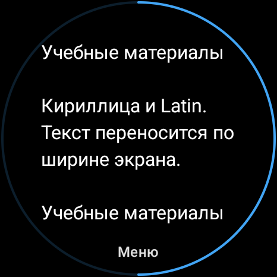

<p align="center"></p>

<p align="center">
  <a href="https://github.com/Hoccku22/WristHub/releases/latest"></a>
  <a href="https://github.com/Hoccku22/WristHub/actions/workflows/android.yml"></a>
  
  
</p>

<p align="center"><strong>Личный файловый хаб на запястье.</strong><br>
Передавай файлы с телефона, слушай музыку, читай PDF и открывай APK на часах.<br>
Бесплатно, без рекламы, аккаунтов и облачного обмена файлами.</p>

<p align="center"><a href="#скачать">Скачать</a> · <a href="docs/INSTALL.md">Установка</a> · <a href="docs/HUB.md">Музыка и APK</a> · <a href="docs/BUILD.md">Сборка</a> · <a href="CHANGELOG.md">Изменения</a></p>

## Скачать

<p align="center">
  <a href="https://github.com/Hoccku22/WristHub/releases/latest/download/WristHub-phone.apk"></a>
  <a href="https://github.com/Hoccku22/WristHub/releases/latest/download/WristHub-watch.apk"></a>
</p>

| Файл | Устройство | Версия |
|---|---|---|
| [WristHub-phone.apk](https://github.com/Hoccku22/WristHub/releases/latest/download/WristHub-phone.apk) | Телефон, Android 8.0+ | 2.1 |
| [WristHub-watch.apk](https://github.com/Hoccku22/WristHub/releases/latest/download/WristHub-watch.apk) | Часы, Wear OS на Android 11+ | 2.1 |

**Раньше приложение называлось WristReader.** WristHub обновляется поверх него: библиотека и настройки сохраняются. Для новых типов файлов обнови оба приложения. Внутренние Android-идентификаторы остались прежними для совместимости.

APK подписаны прежним debug-ключом. Это сборки для самостоятельной установки; контрольные суммы и исходники находятся в [Releases](https://github.com/Hoccku22/WristHub/releases).

## Интерфейс 2.1

На телефоне — файлы и фильтры, выбор нескольких позиций, общий размер и очередь отправки.
Нижняя навигация ведёт к файлам, передачам, выбору часов и настройкам.
На часах подтверждение удаления открывается отдельным диалогом поверх списка;
позиция прокрутки больше не прячет кнопки. Полное обновление оформления часов ещё согласовывается.

## Один хаб — разные файлы

| Раздел | Возможности |
|---|---|
| **Файлы** | Любые типы до 512 МиБ, Bluetooth Classic RFCOMM, SHA-256, отмена и повтор |
| **Музыка** | Локальное аудио, воспроизведение в фоне, пауза, перемотка, очередь, системные медиакнопки |
| **Приложения** | Передача одиночных APK и запуск системного установщика по нажатию пользователя |
| **Чтение** | PDF: слайды, лента и адаптивный текст; головка, жесты, сохранение позиции |
| **Изображения** | Просмотр во весь экран, сохранение пропорций, перемещение, масштаб и меню по касанию |
| **Библиотека** | Категории «Все», «Чтение», «Музыка», «APK», «Другое», удаление с подтверждением |

Сохранить файл можно независимо от того, есть ли на часах приложение для его открытия. Для других типов WristHub предлагает системное «Открыть в приложении».

## Как пользоваться

1. Открой WristHub на часах и разреши Bluetooth — приём включится автоматически.
2. На телефоне выбери сопряжённые часы и любые файлы. Поддерживается системное меню «Поделиться».
3. Нажми «Отправить» и дождись **«Доставлен ✓»**. Не сворачивай приложение часов до окончания передачи.
4. Открой файл из библиотеки. Музыка продолжает играть после сворачивания; приём файлов при сворачивании прекращается.

```text
Телефон                 Bluetooth RFCOMM                 Часы
Любые файлы  ───────────────────────────────────►  Библиотека WristHub
PDF + текст             SHA-256 + подтверждение     Чтение · Музыка · APK
```

## Установка APK на часах

Открой переданный APK и нажми **«Установить APK»**. Если Android запросит доступ, разреши WristHub установку из этого источника, вернись и повтори нажатие. Окончательное решение принимает системный установщик.

Нужен APK, совместимый с версией Android, процессором и экраном часов. Split APK, APKS, XAPK и пакеты AAB не устанавливаются как одиночный APK. Перенос файла не переносит данные, авторизацию и покупки установленного приложения.

Прошивка может ограничивать установку из приложений или не предоставлять нужный экран разрешений. Тогда файл останется в библиотеке, а для установки потребуется ADB. [Подробнее →](docs/HUB.md)

Для первой установки самого WristHub можно использовать компьютер с ADB или Wear Installer 2 на телефоне. Последний тоже использует беспроводную отладку, но не требует командной строки. [Инструкция →](docs/INSTALL.md)

## Музыка без телефона

Выбери аудиофайл в разделе «Музыка». Есть пауза, перемотка на 15 секунд, предыдущий и следующий трек. Очередь составляется из аудиофайлов библиотеки в порядке их отображения. После последнего трека воспроизведение останавливается.

Плеер работает в отдельной foreground-службе с MediaSession и системным уведомлением. Учитывает audio focus и отключение аудиоустройства. Поддержка конкретного кодека и вывод звука зависят от часов; подключи Bluetooth-наушники или используй доступный системный аудиовыход. Трансляции и стриминга с телефона нет.

## Читалка WristReader осталась внутри

<table><tr>
<td align="center"><br><strong>Слайды</strong></td>
<td align="center"><br><strong>Лента</strong></td>
<td align="center"><br><strong>Текст</strong></td>
</tr></table>

Снимки демонстрационного документа с Xiaomi Watch 2 Pro, сделанные для версии 1.x. PDF сохраняет тонкое синее кольцо прогресса с выключателем в настройках. Изображения открываются без него.

## Совместимость

- Основное устройство проверки — Xiaomi Watch 2 Pro, API 34. Другие прошивки и модели отдельно не проверялись.
- В приложении нет разрешения `INTERNET`, HTTP-клиента, Data Layer или сетевого резерва. Wi-Fi может понадобиться только для отладочной установки. [Транспорт →](docs/TRANSPORT.md)
- PDF без OCR: сканы доступны как страницы; извлечённый текст может терять сложную вёрстку. Лимиты: оригинал 512 МиБ, текст 32 МиБ, резерв 8 МиБ.
- PDF рендерится с ограничением 640 × 2048 px, изображения декодируются с уменьшением больших исходников. Увеличение не добавляет детализацию.
- Конкретные выполненные проверки и ограничения описаны в [TESTING.md](docs/TESTING.md).

## Разработчикам

**JDK 17 · Kotlin 2.1.10 · Gradle 8.11.1 · Android SDK 35**

```bash
./gradlew :mobile:assembleDebug :wear:assembleDebug :wear:assembleDebugAndroidTest
./gradlew :shared:testDebugUnitTest :mobile:lintDebug :wear:lintDebug
```

На Windows используй `gradlew.bat`. [Подробности сборки →](docs/BUILD.md)

`mobile/` — выбор и подготовка файлов, `wear/` — библиотека, читалка, плеер и действия с файлами, `shared/` — протокол WR01, Bluetooth и хранилище.

[Сообщить об ошибке](https://github.com/Hoccku22/WristHub/issues/new/choose) · [Сторонние компоненты](docs/THIRD_PARTY.md). Отдельная лицензия на переиспользование исходников пока не выбрана.
